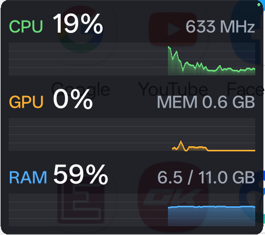

# oppo-gpu-stats

App Android hiển thị overlay CPU / GPU / RAM nổi trên mọi ứng dụng (kiểu GPU Watcher của Samsung).
Phần lấy số liệu và vẽ overlay viết bằng C++ (NDK), phần Java chỉ giữ cửa sổ overlay và dựng font hệ thống.



## Cấu trúc

| Đường dẫn | Nội dung |
|---|---|
| `app/src/main/cpp/stats.cpp` | Đọc `/proc/stat`, cpufreq, GPU sysfs (Adreno/Mali/Samsung/MediaTek), `/proc/meminfo` |
| `app/src/main/cpp/renderer.cpp` | Vẽ chữ + đồ thị vào buffer RGBA bằng CPU |
| `app/src/main/cpp/jni_bridge.cpp` | Luồng native lấy mẫu 500 ms, vẽ thẳng lên `ANativeWindow`; kết nối statd |
| `app/src/main/cpp/statd.cpp` | Daemon chạy bằng quyền shell, phát số liệu qua `127.0.0.1:27183` |
| `app/src/main/java/.../OverlayService.java` | Foreground service, cửa sổ `TYPE_APPLICATION_OVERLAY`, atlas font hệ thống |
| `tools/statd.sh` | Build statd bằng NDK, push và chạy qua adb |

## Vì sao cần statd

Android 8+ chặn app thường đọc `/proc/stat`, và nhiều máy (OPPO/OnePlus, Android 14+) chặn cả GPU sysfs,
kể cả với adb shell. Không có statd, app chỉ ước lượng CPU theo tần số và GPU hiện `N/A`.

statd chạy bằng quyền shell nên đọc được:

- CPU: tải thật từ `/proc/stat`
- GPU: tải từ sysfs nếu đọc được, nếu không thì tính từ `dumpsys gpu --gpuwork`
  (tổng thời gian GPU bận của mọi uid, có trên Android 14+)
- Bộ nhớ GPU: `dumpsys gpu`

Overlay hiện chấm xanh ở góc phải trên khi đang nhận số liệu từ statd.

```bash
./tools/statd.sh            # build theo ABI của máy đang cắm, push và chạy nền
./tools/statd.sh --root     # máy đã root: chạy bằng su
```

statd chạy đến khi khởi động lại máy; sau khi reboot cần chạy lại lệnh trên.

## Build

Cần Android SDK, NDK `28.2.13676358`, CMake `3.22.1`, JDK 17+.

```bash
./gradlew assembleDebug
adb install -r app/build/outputs/apk/debug/app-debug.apk
```

Mở app → cấp quyền "Hiển thị trên ứng dụng khác" → **Bật overlay**.
Kéo overlay để di chuyển, chạm đúp để đổi chế độ gọn (chỉ chữ).
"Khóa vị trí" cho phép chạm xuyên qua overlay (Android 12+ yêu cầu độ mờ ≤ 0.8 nên overlay sẽ nhạt hơn).

## Gitflow và CI/CD

| Nhánh | Mục đích | CI |
|---|---|---|
| `main` | Bản đã phát hành, mỗi release gắn tag `vX.Y.Z` | build release |
| `develop` | Nhánh tích hợp | build debug + lint |
| `feature/*` | Tính năng mới, tách từ `develop`, merge lại `develop` | build debug + lint |
| `release/*` | Chuẩn bị phát hành, tách từ `develop`, merge vào `main` và `develop` | build release |
| `hotfix/*` | Sửa lỗi gấp, tách từ `main`, merge vào `main` và `develop` | build release |

Push tag `v*` sẽ tạo GitHub Release kèm APK và statd cho `arm64-v8a`, `armeabi-v7a`, `x86_64`.

Ký APK release: thêm các secret `KEYSTORE_BASE64` (keystore mã hóa base64), `KEYSTORE_PASSWORD`,
`KEY_ALIAS`, `KEY_PASSWORD`. Chưa có secret thì bản release được ký bằng debug key.
